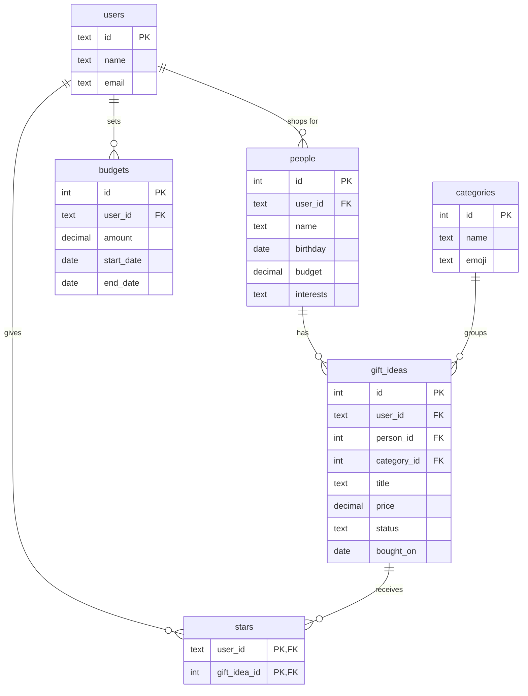

# Presently 🎀

> **The right present, right on time.** Save gift ideas for your people all year, and never miss a birthday.

---

## 1. Pitch

I'm building **Presently** because I always think of the perfect gift for someone in July ("she said she wants a matcha set!") and then forget it by her birthday in November, and then panic-buy something generic. Presently gives every person in my life a page where I save gift ideas the moment I think of them. It counts down to their birthday and, when I'm stuck, asks me 5 quick questions and suggests real products (with photos and links from trusted stores).

**How often I'll use it:** a few times a week in Nov–Dec (holiday shopping), plus before every friend or family birthday the rest of the year (about 2–3 a month).

**Free for everyone, always:** I see people spending so much time hunting for the right gift that I want to make it simple, and keep Presently free for anyone to use. So every service in this plan runs on a free tier with no credit card.

---

## 2. Features (user stories, in build order)

Each numbered feature = one Issue → one branch → one PR.

### Spine
| # | Feature | User story |
|---|---|---|
| 0 | Plan | *(this file, merged before any feature PR)* |
| 1 | Sign up, log in, log out | As a **new visitor**, I want to **create an account with my email and a password, then log in and log out**, so that **my gift lists are private to me**. |
| 2 | People (CRUD) | As a **gift-giver**, I want to **add a person with their name, relationship, birthday, budget and interests, see everyone in a list, open their page, edit them and delete them (with an "are you sure?" popup)**, so that **I have one place for everyone I shop for**. |
| 3 | Gift ideas (CRUD) + categories | As a **gift-giver**, I want to **save a gift idea for a person with a title, category, price, link, occasion and status (idea → bought → given), and edit or delete it**, so that **I never lose an idea again**. |
| 4 | Validation | As a **user**, I want to **see a friendly message (e.g. "Your person needs a name 🙂") when I leave a required field blank or type a negative price**, so that **I don't save broken entries**. |
| 5 | Stars | As a **user**, I want to **star my favorite gift ideas and open a "Starred ⭐" page**, so that **my top picks are one tap away when I'm actually shopping**. |
| 6 | Find things | As a **user**, I want to **search ideas by title, filter by person, category or status, and sort by newest, price (low→high / high→low) or soonest birthday**, so that **I can find "skincare under $30 for Priya" in seconds**. |
| 7 | Dashboard | As a **user**, I want to **see my total spent this season, average gift price, number of ideas not yet bought, and a chart of spending by category**, so that **I know where my money is going**. |
| 8 | Test: data isolation | *(test PR: see Section 4)* |

### My 3 features
| # | Feature | User story |
|---|---|---|
| 9 | 🎂 Birthday countdown + reminder banner | As a **user**, I want to **see a countdown chip on each person ("6 days 🎂") and a banner on my dashboard when a birthday is within 14 days**, so that **I start shopping before it's too late**. |
| 10 | 💸 Budget tracker | As a **user**, I want to **set a budget for a season (e.g. "Holidays 2026: $300, Nov 1 – Dec 31") and a per-person budget, and see a progress bar of spent vs. budget**, so that **I don't overspend in December**. |
| 11 | 🔮 Gift-finder quiz (AI ideas) | As a **user who is stuck**, I want to **answer 5 quick questions (who it's for; him / her / them / no preference; 1–3 categories; budget range; occasion + vibe) and get 5 gift ideas with a "why this fits" line**, so that **I get ideas that actually match the person**. |
| 12 | 🛍️ Real product photos + trusted links | As a **user**, I want **each suggestion to show a real product photo, price, store name and a Shop button from a trusted store, plus a "+ Save" button**, so that **I can see the gift and buy it with confidence**. |

### Bonus (free, built only after 1–12 are live)
| # | Feature | User story |
|---|---|---|
| 13 | Continue with Google | As a **new visitor**, I want to **sign up with my Gmail in one click**, so that **I don't need another password**. |
| 14 | Shareable wishlist link | As a **user**, I want to **create a public, read-only link to my own wishlist**, so that **friends and family know what to get me**. |
| 15 | Birthday calendar | As a **user**, I want to **see all birthdays on a month calendar**, so that **I can plan ahead for busy months**. |
| 16 | 🎲 Gift roulette | As an **indecisive user**, I want a **"Surprise me" button that picks a random unbought idea for a person**, so that **I stop overthinking**. |
| 17 | Dark mode | As a **night-time shopper**, I want a **dark theme toggle**, so that **the app is easy on my eyes**. |

---

## 3. Database

Five tables of my own plus the login tables. Auth library tables (`session`, `account`, `verification`) are created by Better Auth to store login sessions and Google sign-ins.

| Table | Column | Type | Notes |
|---|---|---|---|
| **users** | id | text | **PK** |
| | name | text | required |
| | email | text | required, unique |
| | email_verified | true/false | |
| | created_at | date (timestamp) | |
| **people** | id | number (serial) | **PK** |
| | user_id | text | **FK → users.id**, required |
| | name | text | required |
| | relationship | text | friend / family / partner / coworker / other |
| | birthday | date | optional (year optional) |
| | gift_for | text | him / her / them / no preference |
| | interests | text | comma-separated tags, e.g. "matcha, pottery" |
| | budget | number (decimal) | per-person budget, ≥ 0 |
| | notes | text | |
| | created_at | date (timestamp) | |
| **categories** | id | number (serial) | **PK** |
| | name | text | unique: Clothes & accessories, Skincare & beauty, Gaming & tech, Home & cozy, Food & drink, Books & hobbies, Experiences |
| | emoji | text | 👗 🧴 🎮 🕯️ 🍫 📚 🎟️ |
| **gift_ideas** | id | number (serial) | **PK** |
| | user_id | text | **FK → users.id** (owner; used for isolation) |
| | person_id | number | **FK → people.id**, required |
| | category_id | number | **FK → categories.id**, required |
| | title | text | required |
| | price | number (decimal) | ≥ 0 |
| | link | text | URL |
| | image_url | text | URL |
| | store | text | e.g. "Sephora" |
| | status | text | idea / bought / given (default idea) |
| | occasion | text | birthday / holiday / graduation / thank-you / just because |
| | source | text | manual / suggested |
| | bought_on | date | set when status → bought |
| | notes | text | |
| | created_at | date (timestamp) | |
| **stars** *(junction)* | user_id | text | **FK → users.id**, part of PK |
| | gift_idea_id | number | **FK → gift_ideas.id**, part of PK |
| | created_at | date (timestamp) | |
| **budgets** | id | number (serial) | **PK** |
| | user_id | text | **FK → users.id** |
| | name | text | required, e.g. "Holidays 2026" |
| | amount | number (decimal) | required, > 0 |
| | start_date | date | required |
| | end_date | date | required, after start_date |
| **product_cache** | query | text | **PK**: normalized search, e.g. "matcha starter kit" |
| | results | JSON | trusted-store products from the last search |
| | fetched_at | date (timestamp) | reused for 7 days to save free API credits |

**How tables connect:**
- **users → people**: one-to-many (a user shops for many people)
- **people → gift_ideas**: one-to-many (a person has many gift ideas)
- **categories → gift_ideas**: one-to-many (a category has many gift ideas; categories are a shared, seeded list)
- **users ↔ gift_ideas through stars**: many-to-many (one row = "this user starred this idea"; one table for everyone)
- **users → budgets**: one-to-many
- `product_cache` holds no personal data and isn't linked to anyone.
- Deleting a person deletes their gift ideas, and deleting an idea removes its stars (cascade).

**Real data:** I'll enter real people I'm shopping for this holiday season (first names only) and at least 5 real gift ideas.

---

## 4. Tests

Written with **Vitest**, run against a separate **Neon test branch** of the database, so tests never touch my real data.

**Test 1: Data isolation**
> **Given** User A has a person "Priya" with a gift idea "Matcha starter kit", and User B is a separate new account,
> **when** User B loads their people list, their gift ideas list, and tries to open User A's gift idea by its ID,
> **then** User B's lists are empty and opening User A's idea returns "not found" (404).

**Test 2: Dashboard stat ("Total spent this season" + "Average gift")**
> **Given** a user with a budget "Holidays 2026" (Nov 1 – Dec 31) and four gift ideas: $20 *bought* on Nov 5, $30 *given* on Nov 20, $50 *bought* on Dec 1, and $100 still an *idea*,
> **when** the dashboard stats are calculated,
> **then** "Total spent" is **$100.00** and "Average gift" is **$33.33**: the $100 unbought idea is not counted.

---

## 5. Technologies (all free, no credit card)

| Tool | Why |
|---|---|
| **Claude Code** (coding agent) | I've used it all semester and it can run git, tests and the database tools for me. |
| **Next.js + TypeScript** | One project for pages and server code, and it deploys to Vercel in one click. |
| **Tailwind CSS** | Fast to get a bold, playful look without writing a lot of CSS by hand. |
| **Neon Postgres** (free tier) | A real SQL database, and free branches give me a separate test database. |
| **Drizzle ORM** | Defines my tables in TypeScript, so the schema in code matches Section 3. |
| **Better Auth**: email + password, plus Google sign-in | Free and open source, it stores users in my own database, and Google sign-in is free to enable. (Phone/SMS login is skipped because texts cost money.) |
| **Vercel** (Hobby, free) | Free hosting that redeploys automatically every time I merge to main. |
| **Google Gemini API** (free tier, `gemini-2.5-flash`) | Generates gift ideas from the quiz answers for free. Only interests, categories and budget are sent, never names or birthdays. |
| **Serper.dev** Google Shopping API (2,500 free searches) | Turns each AI idea into real products with a photo, price, store and link. Results are cached for 7 days, and each user is limited to 10 quiz runs a day so the free credits last. |
| **Trusted-store whitelist** (my own code) | Only shows products from Amazon, Target, Walmart, Etsy, Sephora, Ulta, Nordstrom, Best Buy, Apple, REI, Uncommon Goods and Barnes & Noble, so every link is credible. |
| **Recharts** | Simple React charts for the dashboard. |
| **canvas-confetti** | Free confetti burst when a gift is marked *Given* 🎉. |
| **Vitest** | Fast test runner that works with TypeScript out of the box. |

**Sign up / login flow:** On the landing page you choose "Sign up". Email + password (8+ characters) or "Continue with Google" creates a row in `users` and a login session cookie. Every page and database query is filtered by the logged-in user's ID, and "Log out" clears the session.

---

## 6. Design

**Vibe:** cool, fun, a little chaotic, like a party invite, not a spreadsheet.

- **Colors:** cream background `#FFF8EE`, hot pink `#FF4F9A` (main buttons), tangerine `#FF8A3D` (countdowns), lime `#C6F432` (bought/given), lilac `#B9A6FF` (tags), ink `#1A1A1A` (text)
- **Fonts** (Google Fonts, free): **Bricolage Grotesque** for big chunky headings, **DM Sans** for body text
- **Style:** thick rounded cards with a hard 2px black outline and offset "sticker" shadow, pill-shaped tags, big emoji, cards that tilt slightly on hover, and confetti on *Given*
- **Copy:** playful, e.g. empty state "No one to shop for? Suspicious 👀", countdown "Priya's bday in 6 days 🎂", validation "Your person needs a name 🙂"
- **Mobile-first:** I'll mostly use it on my phone while shopping
- **Inspiration:** **Partiful** (party-invite energy, bold colors) and **Spotify Wrapped** (big colorful stat cards for the dashboard)

---

## 7. Risks and cuts

**Least sure I can build:** **#12, real product photos + trusted links.** Google Shopping results don't always come from a store on my whitelist, some links go through a Google redirect instead of straight to the store, and 2,500 free searches can run out if I'm careless in testing.
*Plan B:* filter by the store name that Serper returns, cache everything, and if no trusted result is found, show a store search link instead (e.g. `target.com/s?searchTerm=matcha+kit`) with a hand-picked backup image. If the API is down during the demo, a small backup list of 30 hand-picked gifts (with images) is shown.

**Also risky:** the Gemini free tier has rate limits, so a whole class hitting the quiz at once could be slowed down. The backup list covers this too.

**What I'll cut first if I run out of time (in this order):**
1. Bonus features #14–#17 (share link, calendar, roulette, dark mode)
2. #13 Continue with Google (email + password still satisfies the spine)
3. #12 real photos → fall back to AI ideas + trusted store *search* links
4. Per-person budgets (keep the season budget only)

The spine (#1–#8) and my 3 features (#9, #10, #11) are never cut.
