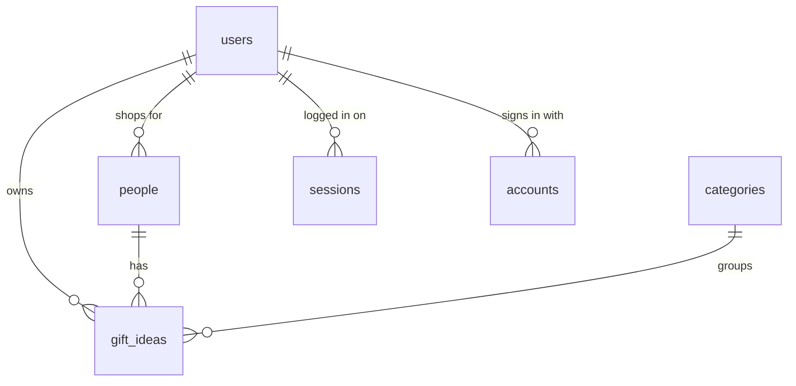

# Presently database schema

This describes the tables that exist in the database right now. It's updated as features ship, and the source of truth is `src/db/schema.ts`.

## How the tables relate
- **One user has many people.** Deleting a user deletes their people.
- **One person has many gift ideas.** Deleting a person deletes their ideas.
- **One category has many gift ideas.** A category can't be deleted while ideas use it.
- **Each gift idea also stores its owner** (`user_id`), so every query can filter by the logged-in user directly.

## My tables

### users
Every account is one row here.

| Column | Type | Notes |
|---|---|---|
| id | text | Primary key |
| name | text | Required |
| email | text | Required, unique |
| email_verified | true/false | Defaults to false |
| image | text | Optional |
| created_at, updated_at | timestamp | |

### people
Everyone a user shops for.

| Column | Type | Notes |
|---|---|---|
| id | number | Primary key |
| user_id | text | Foreign key → users |
| name | text | Required |
| relationship | text | friend / family / partner / coworker / other |
| birthday | date | Optional |
| gift_for | text | him / her / them / no preference |
| interests | text | Comma-separated |
| budget | number | Optional |
| notes | text | Optional |
| created_at | timestamp | |

### categories
A shared list of 7, seeded in the migration: Clothes & accessories, Skincare & beauty, Gaming & tech, Home & cozy, Food & drink, Books & hobbies, Experiences.

| Column | Type | Notes |
|---|---|---|
| id | number | Primary key |
| name | text | Required, unique |
| emoji | text | Required |

### gift_ideas
The main item in the app.

| Column | Type | Notes |
|---|---|---|
| id | number | Primary key |
| user_id | text | Foreign key → users |
| person_id | number | Foreign key → people |
| category_id | number | Foreign key → categories |
| title | text | Required |
| price | number | Optional |
| link | text | Only http/https links are kept |
| image_url | text | Not used yet. Feature #12 fills it in. |
| store | text | Optional |
| status | text | idea / bought / given |
| occasion | text | birthday / holiday / graduation / thank-you / just because |
| source | text | manual / suggested |
| bought_on | date | Set automatically on purchase |
| notes | text | Optional |
| created_at | timestamp | |

## Login tables
Better Auth uses these, and they aren't in the main list in PLAN.md Section 3.

| Table | What it holds |
|---|---|
| sessions | One row per logged-in browser, deleted on log out |
| accounts | How a user signs in. For email sign-ups, this holds the hashed password. |
| verifications | Short-lived tokens |

## Compared with PLAN.md Section 3
| Planned | In the database? | Notes |
|---|---|---|
| users | Yes | Also has `image` and `updated_at`, which Better Auth needs |
| people | Yes | `birthday` needs a full date, while the plan said the year was optional |
| categories | Yes | Matches the plan |
| gift_ideas | Yes | Matches the plan |
| stars | Not yet | Feature #5 |
| budgets | Not yet | Feature #10 |
| product_cache | Not yet | Feature #12 |
