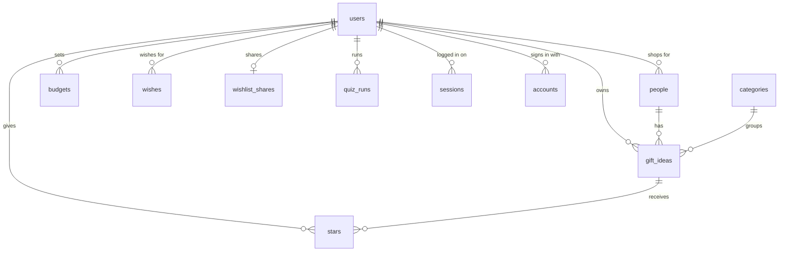

# Presently database schema

These are the tables in the database. The source of truth is `src/db/schema.ts`.

## How the tables relate
- **One user has many people.** Deleting a user deletes everything of theirs.
- **One person has many gift ideas.** Deleting a person deletes their ideas.
- **One category has many gift ideas.** A category can't be deleted while ideas use it.
- **Users and gift ideas are many-to-many through `stars`.** One row means "this user starred this idea", with one table for everyone.
- **One user has many budgets, wishes and quiz runs**, and at most one wishlist share link.

## Main tables

### users
| Column | Type | Notes |
|---|---|---|
| id | text | Primary key |
| name | text | Required |
| email | text | Required, unique |
| email_verified | true/false | |
| image | text | Optional |
| created_at, updated_at | timestamp | |

### people
| Column | Type | Notes |
|---|---|---|
| id | number | Primary key |
| user_id | text | Foreign key → users |
| name | text | Required |
| relationship | text | friend / family / partner / coworker / other |
| birthday | date | Optional |
| gift_for | text | him / her / them / no preference |
| interests | text | Comma-separated |
| budget | number | Optional |
| notes | text | Optional |
| created_at | timestamp | |

### categories
A shared list of 9, seeded in migrations: Accessories, Books & hobbies, Clothing, Experiences, Food & drink, Gaming & tech, Home & cozy, Shoes, Skincare & beauty. The plan had 7. "Clothes & accessories" was split into Clothing, Shoes and Accessories in #71.

| Column | Type | Notes |
|---|---|---|
| id | number | Primary key |
| name | text | Required, unique |
| emoji | text | Required |

### gift_ideas
The main item in the app.

| Column | Type | Notes |
|---|---|---|
| id | number | Primary key |
| user_id | text | Foreign key → users |
| person_id | number | Foreign key → people |
| category_id | number | Foreign key → categories |
| title | text | Required |
| price | number | Optional |
| link | text | Only http/https links are kept |
| image_url | text | Unused since product photos were removed (#64) |
| store | text | Optional |
| status | text | idea / bought / given |
| occasion | text | birthday / holiday / graduation / thank-you / just because |
| source | text | manual / suggested |
| bought_on | date | Set automatically on purchase |
| notes | text | Optional |
| created_at | timestamp | |

### stars (junction table)
| Column | Type | Notes |
|---|---|---|
| user_id | text | Foreign key → users, part of the primary key |
| gift_idea_id | number | Foreign key → gift_ideas, part of the primary key |
| created_at | timestamp | |

### budgets
| Column | Type | Notes |
|---|---|---|
| id | number | Primary key |
| user_id | text | Foreign key → users |
| name | text | Required |
| amount | number | Required, above 0 |
| start_date, end_date | date | Required |
| created_at | timestamp | |

### wishes
Things a user wants for themselves.

| Column | Type | Notes |
|---|---|---|
| id | number | Primary key |
| user_id | text | Foreign key → users |
| title | text | Required |
| link | text | Optional |
| price | number | Optional |
| notes | text | Optional |
| created_at | timestamp | |

### wishlist_shares
A row here makes that user's wishlist public at `/w/<token>`.

| Column | Type | Notes |
|---|---|---|
| user_id | text | Primary key, foreign key → users |
| token | text | Required, unique, random |
| created_at | timestamp | |

## Supporting tables
| Table | What it holds |
|---|---|
| quiz_runs | One row per AI quiz run, for the daily limit of 10 |
| product_cache | Unused since product photos were removed (#64). Kept rather than deleting a table from the live database. |
| sessions | One row per logged-in browser, deleted on log out |
| accounts | How a user signs in. For email sign-ups, this holds the hashed password. |
| verifications | Short-lived tokens |

## Compared with PLAN.md Section 3
| Planned | Built? | Notes |
|---|---|---|
| users | Yes | Also has `image` and `updated_at`, which Better Auth needs |
| people | Yes | `birthday` needs a full date, while the plan said the year was optional |
| categories | Changed | 9, not 7: "Clothes & accessories" was split into Clothing, Shoes and Accessories (#71) |
| gift_ideas | Yes | Matches the plan |
| stars | Yes | Matches the plan |
| budgets | Yes | Also has `created_at` |
| product_cache | Yes | Matches the plan |
| Not in the plan | Added | `quiz_runs`, `wishes` and `wishlist_shares` |

The agent built what I designed, plus three tables the plan had missed.
